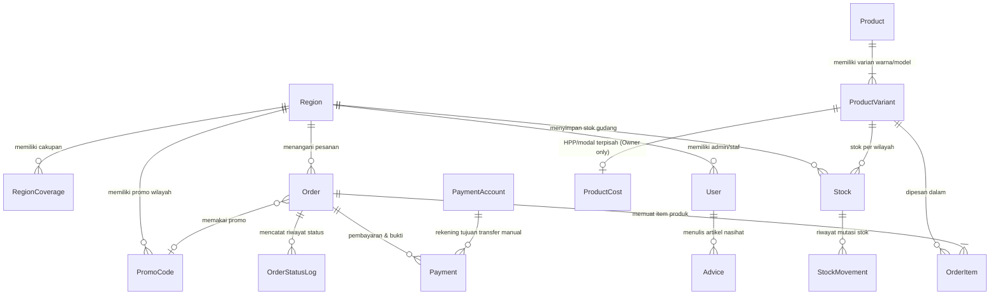

# LUVIRA 2.0: Dokumentasi Skema Database (DB_SCHEMA.md)

Dokumentasi ini menjelaskan model data PostgreSQL yang digunakan dalam Luvira 2.0 sesuai dengan arsitektur multi-wilayah, multi-peran, dan isolasi data sensitif.

---

## 1. Diagram Relasi Entitas (ERD)

---

## 2. Rincian Entitas Utama

### A. Wilayah & Cakupan (`Region`, `RegionCoverage`)
- **`Region`**: Menampung data gudang fisik Luvira. Tipe `PUSAT` (Kota Depok) dan `WILAYAH` (Yogyakarta). Menyimpan `originId` RajaOngkir untuk titik penentu ongkos kirim.
- **`RegionCoverage`**: Memetakan provinsi/kabupaten ke wilayah yang melayani (mis. DI Yogyakarta diarahkan ke Yogyakarta; lainnya diarahkan ke Pusat via fallback default).

### B. Pengguna & Otorisasi (`User`)
- Memiliki 4 peran sistem: `ADMIN_PUSAT`, `ADMIN_WILAYAH`, `OWNER`, `DEVELOPER`.
- `regionId`: Terisi untuk `ADMIN_WILAYAH` untuk menegakkan isolasi wilayah secara ketat di level query Prisma. `null` untuk Owner, Developer, dan Admin Pusat.
- Mendukung penguncian akun (`failedLoginAttempts`, `lockedUntil`) dan status `isActive`.

### C. Katalog, Stok, dan Proteksi HPP (`Product`, `ProductVariant`, `ProductCost`, `Stock`, `StockMovement`)
- **`Product`**: Menyimpan deskripsi, nama, harga jual seragam di seluruh Indonesia, dan fitur produk.
- **`ProductVariant`**: Menyimpan SKU unik, nama warna, kode hex, berat (default 35 gram), dan URL gambar ImageKit.
- **`ProductCost`**: **Terpisah dari Product & Variant**. Hanya menyimpan `costPrice` (HPP) dan `packingCost`. Kolom ini dilarang di-select untuk selain Owner dan Developer.
- **`Stock`**: Compound unique `[variantId, regionId]`. Memisahkan stok fisik (`qty`) dan stok yang sedang dipesan (`reserved`).
- **`StockMovement`**: Catatan append-only perubahan stok (tipe: `IN`, `OUT`, `RESERVE`, `RELEASE`, `ADJUSTMENT`).

### D. Pesanan & Pembayaran (`Order`, `OrderItem`, `OrderStatusLog`, `Payment`, `PaymentAccount`)
- **`Order`**: Menyimpan kode unik pesanan (`LVR-YYYYMMDD-XXXX`), status, snapshot alamat pembeli, kalkulasi subtotal, diskon, PPN 11% net, dan ongkir.
- **`OrderItem`**: Menyimpan snapshot harga jual dan HPP historis saat transaksi dilakukan (untuk laporan akuntansi Owner).
- **`OrderStatusLog`**: Catatan perpindahan status pesanan oleh actor tertentu.
- **`Payment`**: Menyimpan verifikasi pembayaran, tautan bukti transfer ImageKit, atau detail transaksi Midtrans.
- **`PaymentAccount`**: Rekening bank resmi yang dikelola Owner (Bank Jago Syariah & BSI).

### E. Promo & Nasihat (`PromoCode`, `Advice`)
- **`PromoCode`**: Mendukung promo reseller nasional (`type = RESELLER`) dan promo wilayah (`type = WILAYAH`). Validasi kuota, minimal belanja, dan batas maksimum diskon.
- **`Advice`**: Artikel nasihat/edukasi untuk pembeli.

### F. Observabilitas & Sistem (`Setting`, `Notification`, `AuditLog`, `ErrorLog`, `DailyTraffic`, `ShippingCache`)
- **`Setting`**: Konfigurasi dinamis sistem (PPN rate, ambang stok menipis, kurir aktif).
- **`Notification`**: Notifikasi pesanan baru / bukti baru berbasis peran dan wilayah.
- **`AuditLog`**: Append-only log seluruh mutasi penting (siapa, aksi, entitas, sebelum, sesudah).
- **`ErrorLog`**: Pencatatan exception server & client boundaries dengan pembatasan retensi.
- **`DailyTraffic`**: Agregasi jumlah pengunjung harian per rute.
- **`ShippingCache`**: Cache kalkulasi ongkir dan destinasi RajaOngkir dengan TTL.
