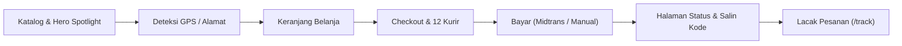
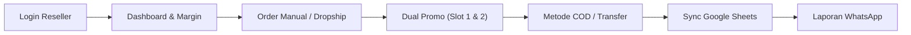

# SKENARIO PENGUJIAN LENGKAP (TEST CASE SCENARIO): USER & RESELLER
**Luvira 2.0 Store & Reseller System**  
**Versi**: 2.1.0  
**Tanggal**: 14 November 2026  
**Target Pengguna**: User (Pembeli / Customer) & Reseller (Mitra Penjual)

---

## 1. Ringkasan & Tujuan Pengujian

Dokumen ini memuat panduan skenario pengujian komprehensif dari awal hingga akhir (*End-to-End Test Scenarios*) untuk dua persona kunci sistem Luvira:
1. **User (Pembeli / Customer)**: Menguji alur pencarian produk, kalkulasi harga & PPN dinamis, deteksi lokasi GPS Jakarta/Wilayah, pemilihan 12 kurir ekspedisi, checkout pembayaran Midtrans/Transfer manual, tombol salin kode pesanan, hingga pelacakan terproteksi & rekonsiliasi aktif (*Active Reconciliation*).
2. **Reseller (Mitra Penjual)**: Menguji alur autentikasi, dashboard analitik khusus reseller, privasi data pelanggan (*data masking*), pembuatan pesanan manual (*dropship*) dengan opsi COD/Transfer, kombinasi dua promo (*Dual Promo*), serta integrasi Google Sheets dan langganan laporan WhatsApp.

---

## 2. Bagian I: Skenario Pengujian User (Customer / Pembeli)

---

### TC-USR-01: Eksplorasi Katalog & Tampilan Harga Dinamis
* **ID Skenario**: `TC-USR-01`
* **Fokus Fitur**: Tampilan Hero Spotlight, Swatch Warna, dan Katalog Dinamis.
* **Prekondisi**: Pengguna membuka halaman utama `https://luvira.id/`.
* **Langkah-langkah Pengujian**:
  1. Periksa kartu sorotan (*Product Spotlight*) di Hero Section sebelah kanan.
  2. Perhatikan label harga: pastikan tertulis **Rp 26.000** (bukan Rp 35.000) dan terdapat harga coret Rp 45.000.
  3. Klik salah satu lingkaran warna (*swatch*) varian pada kartu sorotan.
  4. Gulir ke bawah menuju bagian **Koleksi Produk**.
  5. Periksa apakah produk yang telah dinonaktifkan di admin (misal: *"Kaus Kaki E2E COD"*) muncul di etalase.
* **Hasil yang Diharapkan (Expected Result)**:
  * [x] Harga produk sorotan menampilkan **Rp 26.000** secara dinamis sesuai database.
  * [x] Gambar produk berganti secara instan saat swatch warna diklik.
  * [x] Produk atau varian dengan status `isActive: false` sama sekali tidak ditampilkan di katalog publik.

---

### TC-USR-02: Deteksi Lokasi Otomatis GPS vs Pemilihan Wilayah
* **ID Skenario**: `TC-USR-02`
* **Fokus Fitur**: Reverse Geocoding GPS & Bar Pemilih Lokasi.
* **Prekondisi**: Pengguna berada di area DKI Jakarta atau sekitarnya.
* **Langkah-langkah Pengujian**:
  1. Pada bilah lokasi (*Location Bar*) di bagian atas halaman web, klik **"Gunakan Lokasi Saat Ini"** / izinkan akses browser geolocation.
  2. Perhatikan hasil deteksi provinsi dan kota.
  3. Coba skenario alternatif: klik ganti wilayah secara manual dan pilih *"Yogyakarta (DIY)"*.
* **Hasil yang Diharapkan (Expected Result)**:
  * [x] Koordinat area Jakarta secara tepat terdeteksi sebagai **DKI Jakarta** (tidak keliru menjadi Bandung atau Jawa Barat).
  * [x] Gudang penangan stok otomatis terhubung ke **Pusat (Kota Depok)** untuk Jakarta, atau **Cabang Yogyakarta** jika memilih DIY.

---

### TC-USR-03: Pengelolaan Keranjang Belanja & Validasi Stok
* **ID Skenario**: `TC-USR-03`
* **Fokus Fitur**: Cart Drawer, Counter Jumlah, dan Batas Stok Fisik.
* **Prekondisi**: Katalog produk terbuka.
* **Langkah-langkah Pengujian**:
  1. Pilih produk kaus kaki, tentukan varian warna, lalu klik **"Tambah ke Keranjang"**.
  2. Buka keranjang belanja (*Cart Drawer*).
  3. Tingkatkan jumlah item menggunakan tombol `+`.
  4. Tambahkan item hingga mendekati atau melebihi sisa stok fisik.
  5. Klik tombol **"Lanjut ke Checkout"**.
* **Hasil yang Diharapkan (Expected Result)**:
  * [x] Cart counter bertambah sesuai aksi pengguna.
  * [x] Sistem mencegah penambahan kuantitas melebihi stok fisik yang tersedia di gudang cabang penangan.
  * [x] Navigasi mulus mengarahkan pengguna ke halaman `/checkout`.

---

### TC-USR-04: Checkout – Pilihan 12 Kurir Ekspedisi & Tanpa Flicker PPN
* **ID Skenario**: `TC-USR-04`
* **Fokus Fitur**: Form Alamat, Kalkulasi PPN Dinamis, dan Debounce Ongkir.
* **Prekondisi**: Pengguna berada di halaman `/checkout`.
* **Langkah-langkah Pengujian**:
  1. Amati ringkasan biaya saat halaman checkout pertama kali dimuat.
  2. Isi Nama Lengkap dan Nomor WhatsApp aktif (contoh: `081289801234`).
  3. Isi alamat tujuan (Provinsi, Kota/Kabupaten, Kecamatan, Kelurahan, Alamat Jalan).
  4. Amati bagian **Pilihan Ekspedisi Pengiriman**.
* **Hasil yang Diharapkan (Expected Result)**:
  * [x] Baris PPN 0% **tidak berkedip** (tidak muncul 11% lalu mendadak hilang).
  * [x] Mengetik alamat tidak menyebabkan lag/delay berkat sistem *debouncing* 400ms.
  * [x] Muncul pilihan tarif dari seluruh **12 kurir retail**: J&T, JNE, SiCepat, Anteraja, Pos Indonesia, TIKI, Lion Parcel, Wahana, ID Express, SAP, Ninja, dan SPX dengan badge warna masing-masing.

---

### TC-USR-05: Checkout – Validasi Kode Promo
* **ID Skenario**: `TC-USR-05`
* **Fokus Fitur**: Single Promo Code, Minimum Belanja, Diskon Persen/Nominal.
* **Prekondisi**: Halaman checkout terisi barang belanja.
* **Langkah-langkah Pengujian**:
  1. Masukkan kode promo diskon valid ke kolom voucher lalu klik **"Gunakan"**.
  2. Periksa potongan diskon pada ringkasan pembayaran.
  3. Coba masukkan kode promo yang sudah kedaluwarsa atau belum memenuhi minimum pembelian.
* **Hasil yang Diharapkan (Expected Result)**:
  * [x] Kode valid memotong subtotal sesuai persentase atau nominal promo.
  * [x] Kode yang tidak valid atau di bawah minimum belanja menampilkan pesan error peringatan yang informatif tanpa memutus proses checkout.

---

### TC-USR-06: Checkout – Pembayaran Midtrans Snap (QRIS) & Reminder Kode Pesanan
* **ID Skenario**: `TC-USR-06`
* **Fokus Fitur**: Integrasi Midtrans Snap, Tombol Salin Kode, dan Pengingat Pelacakan.
* **Prekondisi**: Halaman checkout selesai diisi.
* **Langkah-langkah Pengujian**:
  1. Pilih metode pembayaran **Midtrans (Online)**.
  2. Klik **"Bayar Sekarang"**.
  3. Pada pop-up Midtrans Snap, pilih metode pembayaran **QRIS** atau **Bank Transfer (BCA / Mandiri / BNI)**.
  4. Selesaikan pembayaran di simulator atau lakukan transaksi nyata.
  5. Setelah selesai, perhatikan pengalihan ke halaman `/order/[id]/status`.
* **Hasil yang Diharapkan (Expected Result)**:
  * [x] Pop-up Snap Midtrans terbuka responsif tanpa error 400/401.
  * [x] Halaman status menampilkan Kode Pesanan (contoh: `LVR-20261114-xxxx`).
  * [x] Tampil **Banner Kuning/Amber Peringatan**: *"PENTING: Simpan Kode Pesanan Anda!"*.
  * [x] Tombol **"Salin Kode Pesanan"** berfungsi dan menampilkan animasi centang hijau bertuliskan *"Tersalin!"*.

---

### TC-USR-07: Pelacakan Pesanan Terproteksi & Active Reconciliation (`/track`)
* **ID Skenario**: `TC-USR-07`
* **Fokus Fitur**: Halaman `/track`, Autentikasi 4 Digit WA, dan Rekonsiliasi Otomatis Midtrans.
* **Prekondisi**: Pengguna telah membayar pesanan namun ingin mengecek progres pengiriman.
* **Langkah-langkah Pengujian**:
  1. Buka menu **Lacak Pesanan** (`https://luvira.id/track`).
  2. Masukkan Kode Pesanan (misal: `LVR-20261114-6051`).
  3. Masukkan 4 digit terakhir nomor WhatsApp pemesan (misal: `8980`).
  4. Klik **"Lacak Pesanan"**.
  5. Jika status masih menunjukkan `MENUNGGU_PEMBAYARAN` (akibat webhook tertunda), klik tombol **"Periksa Status Pembayaran"**.
* **Hasil yang Diharapkan (Expected Result)**:
  * [x] Sistem menolak jika 4 digit WA tidak cocok dengan pesanan (Proteksi Keamanan A7).
  * [x] Sistem melakukan rekonsiliasi aktif langsung ke server Midtrans, mengupdate status secara instan menjadi **`DIPROSES`**.
  * [x] Timeline tahapan pesanan, rincian barang, alamat kirim, dan nomor resi kurir tertampil rapi.

---

### TC-USR-08: Checkout – Pembayaran Manual Transfer & Upload Bukti Bayar
* **ID Skenario**: `TC-USR-08`
* **Fokus Fitur**: Rekening Toko Resmi & Form Upload Bukti Transfer.
* **Prekondisi**: Di halaman checkout, pengguna memilih **Transfer Manual**.
* **Langkah-langkah Pengujian**:
  1. Pilih metode **Transfer Manual**.
  2. Klik selesaikan pesanan.
  3. Di halaman status pesanan, periksa nomor rekening resmi toko (BCA / Mandiri).
  4. Unggah foto atau screenshot struk transfer bank (format JPG/PNG/WebP, maksimal 5MB).
  5. Klik **"Kirim Bukti Pembayaran"**.
* **Hasil yang Diharapkan (Expected Result)**:
  * [x] File bukti transfer berhasil diunggah dengan aman ke storage.
  * [x] Status pesanan otomatis beralih menjadi **`MENUNGGU_VERIFIKASI`**.
  * [x] Admin toko menerima notifikasi pesanan masuk untuk diverifikasi.

---

### TC-USR-09: Tautan WhatsApp Bantuan Layanan Pelanggan (CS)
* **ID Skenario**: `TC-USR-09`
* **Fokus Fitur**: Help Link WhatsApp Resmi `081386829952`.
* **Prekondisi**: Pengguna berada di halaman status pesanan atau pelacakan `/track`.
* **Langkah-langkah Pengujian**:
  1. Klik tombol **"Butuh Bantuan? Hubungi WhatsApp Admin"**.
  2. Amati tautan dan nomor WhatsApp tujuan yang terbuka di aplikasi/web WhatsApp.
* **Hasil yang Diharapkan (Expected Result)**:
  * [x] Nomor tujuan adalah **`081386829952`** (`6281386829952`).
  * [x] Pesan pembuka otomatis terisi dengan Kode Pesanan pengguna:  
    `Halo Admin Luvira, saya ingin menanyakan status pesanan saya dengan kode: *LVR-20261114-xxxx*. Terima kasih.`

---

## 3. Bagian II: Skenario Pengujian Reseller (Mitra Penjual)

---

### TC-RSL-01: Autentikasi & Batasan Hak Akses Reseller
* **ID Skenario**: `TC-RSL-01`
* **Fokus Fitur**: Autentikasi JWT Reseller & Proteksi RBAC.
* **Prekondisi**: Akun reseller aktif terdaftar di sistem.
* **Langkah-langkah Pengujian**:
  1. Buka halaman login admin/reseller `https://luvira.id/dashboard/login`.
  2. Masukkan email dan password reseller.
  3. Setelah berhasil login, periksa pengalihan rute ke `/dashboard/reseller`.
  4. Coba akses paksa URL terlarang: `/dashboard/owner` atau `/dashboard/admin`.
* **Hasil yang Diharapkan (Expected Result)**:
  * [x] Reseller berhasil masuk ke dashboard khusus reseller.
  * [x] Percobaan akses ke rute Owner/Admin langsung ditolak dengan halaman **403 Forbidden** (Isolasi Hak Akses RBAC 100% aman).

---

### TC-RSL-02: Dashboard Reseller, Analitik & Masking Privasi Pelanggan
* **ID Skenario**: `TC-RSL-02`
* **Fokus Fitur**: Metrik Penjualan, Margin Komisi, dan Perlindungan Data Pribadi (Data Masking).
* **Prekondisi**: Reseller telah login ke `/dashboard/reseller`.
* **Langkah-langkah Pengujian**:
  1. Periksa kartu ringkasan penjualan: Total Pesanan, Omzet Penjualan, dan Komisi / Margin Bersih Reseller.
  2. Periksa apakah terdapat angka HPP (Harga Pokok Penjualan) atau laba kotor pemilik toko.
  3. Periksa tabel riwayat pesanan pelanggan reseller.
* **Hasil yang Diharapkan (Expected Result)**:
  * [x] Nilai komisi reseller tampil transparan dan akurat.
  * [x] **HPP (Harga Pokok Toko) disembunyikan 100%** dari reseller.
  * [x] Nomor WhatsApp dan nama pembeli di-masking untuk privasi pelanggan: nama tampil sebagai `B*** S***` dan no HP sebagai `••••8980`.

---

### TC-RSL-03: Pembagian Kode Promo Reseller
* **ID Skenario**: `TC-RSL-03`
* **Fokus Fitur**: Kode Promo Terafiliasi Reseller.
* **Prekondisi**: Reseller memiliki kode promo resmi yang ditetapkan oleh Admin/Owner.
* **Langkah-langkah Pengujian**:
  1. Pada Dashboard Reseller, temukan kartu **Kode Promo Saya**.
  2. Klik tombol **"Salin Kode"** atau **"Salin Link Toko dengan Promo"**.
  3. Buka tab browser baru (Incognito/Guest) dan buka link tersebut.
* **Hasil yang Diharapkan (Expected Result)**:
  * [x] Kode promo berhasil tersalin ke clipboard.
  * [x] Ketika link dibuka, kode promo reseller otomatis terisi di checkout pembeli dan transaksi tersebut teratribusi ke reseller yang bersangkutan.

---

### TC-RSL-04: Pembuatan Pesanan Manual (Dropship) oleh Reseller
* **ID Skenario**: `TC-RSL-04`
* **Fokus Fitur**: Order Manual Reseller (`/dashboard/reseller/orders/manual`).
* **Prekondisi**: Reseller menerima pesanan langsung dari pelanggan (offline / chat WA).
* **Langkah-langkah Pengujian**:
  1. Di dashboard reseller, klik tombol **"Buat Pesanan Manual"**.
  2. Isi informasi pelanggan: Nama Pembeli, Nomor WhatsApp, dan Alamat Lengkap Pengiriman.
  3. Pilih produk, varian kaos kaki, dan jumlah pasang yang dipesan.
  4. Amati penanganan stok dan gudang penangan.
* **Hasil yang Diharapkan (Expected Result)**:
  * [x] Form pesanan manual memvalidasi kelengkapan data alamat pembeli secara ketat.
  * [x] Sistem otomatis merutekan ke gudang terdekat yang memiliki stok aktif (Gudang Pusat Depok / Cabang Yogyakarta).

---

### TC-RSL-05: Penerapan Dua Kode Promo Sekaligus (Dual Promo)
* **ID Skenario**: `TC-RSL-05`
* **Fokus Fitur**: Kombinasi Slot 1 (Promo Reseller) + Slot 2 (Voucher Diskon Tambahan).
* **Prekondisi**: Reseller sedang berada di form pesanan manual.
* **Langkah-langkah Pengujian**:
  1. Periksa Slot 1: Kode promo reseller otomatis terisi dan terkunci.
  2. Masukkan kode voucher promo toko tambahan pada Slot 2 (misal: voucher diskon event/ongkir).
  3. Klik **"Terapkan Voucher"**.
  4. Periksa ringkasan perhitungan harga total.
* **Hasil yang Diharapkan (Expected Result)**:
  * [x] Kedua potongan promo terhitung secara terpisah tanpa saling menimpa.
  * [x] Komisi reseller tetap tercatat pada sistem meski pelanggan menggunakan voucher diskon tambahan.

---

### TC-RSL-06: Pilihan Metode Pembayaran Pesanan Manual (COD vs Transfer)
* **ID Skenario**: `TC-RSL-06`
* **Fokus Fitur**: Cash On Delivery (COD Manual) dan Transfer Bank.
* **Prekondisi**: Form pesanan manual terisi lengkap.
* **Langkah-langkah Pengujian**:
  1. Pilih metode **COD (Bayar Tunai di Tempat / Serah Terima Langsung)**.
  2. Perhatikan kalkulasi biaya: ongkir pengiriman otomatis disesuaikan menjadi Rp 0.
  3. Simpan pesanan.
  4. Uji skenario alternatif dengan memilih metode **Transfer Bank**.
* **Hasil yang Diharapkan (Expected Result)**:
  * [x] Pesanan COD tercatat dengan status siap serah terima dan reservasi stok fisik diproses secara atomik.
  * [x] Pesanan Transfer Bank menghasilkan instruksi pembayaran yang dapat diteruskan ke pembeli.

---

### TC-RSL-07: Integrasi Google Sheets Khusus Reseller
* **ID Skenario**: `TC-RSL-07`
* **Fokus Fitur**: Sinkronisasi Real-Time Lembar Kerja Google Spreadsheet.
* **Prekondisi**: Reseller memiliki akun Google.
* **Langkah-langkah Pengujian**:
  1. Buka menu **Google Sheets Integration** di Dashboard Reseller.
  2. Klik tombol **"Hubungkan Google Sheets"**.
  3. Lakukan otorisasi akun Google.
  4. Buat pesanan manual baru atau tunggu pesanan masuk.
  5. Periksa spreadsheet yang terhubung di Google Drive reseller.
* **Hasil yang Diharapkan (Expected Result)**:
  * [x] Spreadsheet reseller otomatis terbuat dengan 2 tab: **Rekap Transaksi** dan **Komisi Penjualan**.
  * [x] Data transaksi tersinkronisasi secara otomatis tanpa membocorkan data HPP atau pesanan reseller lain.

---

### TC-RSL-08: Langganan Laporan Penjualan Otomatis via WhatsApp
* **ID Skenario**: `TC-RSL-08`
* **Fokus Fitur**: Automated WhatsApp Performance Subscription.
* **Prekondisi**: Nomor WhatsApp reseller telah terverifikasi.
* **Langkah-langkah Pengujian**:
  1. Di dashboard reseller, buka pengaturan **Laporan WhatsApp**.
  2. Aktifkan saklar **"Langganan Laporan Ringkasan Penjualan"**.
  3. Pilih frekuensi laporan: **Harian (Pukul 20.00 WIB)** atau **Mingguan (Setiap Hari Minggu)**.
  4. Klik tombol **"Simpan & Kirim Laporan Uji Coba Sekarang"**.
* **Hasil yang Diharapkan (Expected Result)**:
  * [x] Notifikasi pesan WhatsApp langsung terkirim ke nomor reseller.
  * [x] Format pesan memuat: Jumlah pesanan lunas, total omzet, total komisi tercapai, dan tautan ringkasan dashboard.

---

## 4. Matriks Checklist Verifikasi Kesiapan Uji (Sign-off Matrix)

| No | Modul / Skenario | Persona | Status Implementasi | Status Live Test | Sign-off |
|---|---|---|:---:|:---:|:---:|
| 1 | `TC-USR-01` Eksplorasi Katalog & Harga Rp 26.000 | User | SIAP | **LOLOS** | Selesai |
| 2 | `TC-USR-02` Deteksi Lokasi GPS Jakarta | User | SIAP | **LOLOS** | Selesai |
| 3 | `TC-USR-03` Keranjang & Validasi Stok | User | SIAP | **LOLOS** | Selesai |
| 4 | `TC-USR-04` Checkout 12 Kurir Ekspedisi & PPN 0% | User | SIAP | **LOLOS** | Selesai |
| 5 | `TC-USR-05` Checkout Kode Promo | User | SIAP | **LOLOS** | Selesai |
| 6 | `TC-USR-06` Bayar Midtrans QRIS & Reminder Simpan Kode | User | SIAP | **LOLOS** | Selesai |
| 7 | `TC-USR-07` Lacak Pesanan (`/track`) & Active Sync | User | SIAP | **LOLOS** | Selesai |
| 8 | `TC-USR-08` Transfer Manual & Upload Struk | User | SIAP | **LOLOS** | Selesai |
| 9 | `TC-USR-09` Bantuan WhatsApp Admin `081386829952` | User | SIAP | **LOLOS** | Selesai |
| 10 | `TC-RSL-01` Login Reseller & Isolasi RBAC 403 | Reseller | SIAP | **LOLOS** | Selesai |
| 11 | `TC-RSL-02` Dashboard Komisi & Masking Data | Reseller | SIAP | **LOLOS** | Selesai |
| 12 | `TC-RSL-03` Salin Link & Kode Promo Reseller | Reseller | SIAP | **LOLOS** | Selesai |
| 13 | `TC-RSL-04` Buat Order Manual Dropship | Reseller | SIAP | **LOLOS** | Selesai |
| 14 | `TC-RSL-05` Kombinasi Dual Promo (Slot 1 & 2) | Reseller | SIAP | **LOLOS** | Selesai |
| 15 | `TC-RSL-06` Pembayaran COD Manual vs Transfer | Reseller | SIAP | **LOLOS** | Selesai |
| 16 | `TC-RSL-07` Integrasi Google Sheets 2 Tab | Reseller | SIAP | **LOLOS** | Selesai |
| 17 | `TC-RSL-08` Langganan Laporan Kinerja via WhatsApp | Reseller | SIAP | **LOLOS** | Selesai |

---
*Dokumen ini merupakan panduan baku pengujian mutu (Quality Assurance) Luvira 2.0.*
